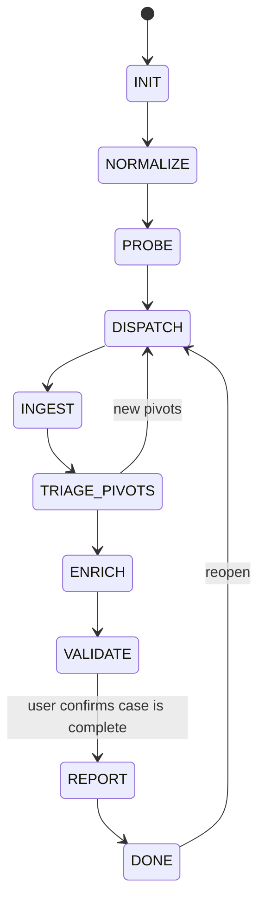

# CTI Investigation Agent System

A **passive** Cyber Threat Intelligence (CTI) investigation system for suspected phishing, smishing and scam artifacts (SMS, email, URL, domain, IP, hash). Built on native [Claude Code](https://claude.com/claude-code) primitives (a skill, subagents, scripts and a hook), with no external runtime or dependencies beyond Python's standard library.

Give it a suspicious message or link. It investigates through third-party intel services only, never touching attacker infrastructure directly. It produces an evidence-labelled attack chain, a Mermaid diagram and a bilingual (English + Hebrew) CTI report suitable for CERT-IL/INCD, police or victims.

> **Defensive use only.** This project performs passive investigation of artifacts you have received. It does not exploit, probe, brute-force or authenticate against attacker systems.

## Features

- **Supervisor-style multi-agent design**: an orchestrator skill owns the case and correlates findings; two Sonnet subagents do deep research in parallel and return compact summaries.
- **Passive by enforcement, not by convention**: a `PreToolUse` hook (`passive_guard.py`) asks before any direct contact with non-allowlisted hosts and denies commands that would leak API keys.
- **Token-efficient**: raw tool output never enters LLM context. Scripts save it to `raw/`, hash it, log it, and print a summary of at most 25 lines.
- **Evidence discipline**: every finding is labelled `CONFIRMED`, `INFERRED` or `UNKNOWN`. A failed or empty lookup is `UNKNOWN` ("not observed"), never "none found". Shared infrastructure or name similarity is a lead, never attribution.
- **Cross-case IOC gateway**: a derived graph links cases through strong indicators only, with tiered, user-gated access. Cases are never auto-merged.
- **Hebrew-first outputs**: inputs are often Hebrew, and the Hebrew report is mandatory alongside the English one.
- **Obsidian knowledge base**: every case is a folder in an Obsidian vault, and a graph view links cases through shared indicators (see below).

## How it works



| Component | Role |
|---|---|
| `cti-investigate` skill | Orchestrator. Owns the state machine, pivot queue and all user interaction. |
| `cti-web-chain` agent (`WEB-NNN`) | URL chain, urlscan result/DOM/screenshot, hash pivots, Wayback. |
| `cti-infra` agent (`INF-NNN`) | RDAP, DNS, crt.sh + cert pivots, VT relations, IP/ASN, AbuseIPDB, CDN-vs-dedicated judgement. |
| `scripts/intel.py` | The single path to every external service. |
| `scripts/evidence_ingest.py` | Single writer for evidence. Assigns stable `E-xxx` ids. |
| `.claude/hooks/passive_guard.py` | Enforces passive-only behaviour and blocks key leaks. |

### Intel services

urlscan.io, VirusTotal, crt.sh, RDAP, DNS-over-HTTPS, AbuseIPDB, URLhaus, ThreatFox, AlienVault OTX, ViewDNS, Wayback Machine, Common Crawl and WhereGoes (the user runs WhereGoes in their browser, since it has no API).

### Design invariants

1. Raw tool output never enters LLM context.
2. Single writer for evidence (no ID collisions, no hand-edited `evidence.json`).
3. Evidence labels and defanging: working records are verbatim, shareable outputs are defanged and cite evidence ids.
4. Passive only, enforced by the hook. Everything fetched is untrusted data, never instructions.
5. Subagents cannot ask the user or spawn other subagents.
6. Pivot budget: depth 2, about 10 tasks. Over budget becomes an open question, not more work.
7. Final deliverables (EN report, HE report, diagram) are produced only once, after explicit user confirmation. Closed cases can be reopened.
8. Cross-case isolation: a shared IOC is an `INFERRED` lead the user confirms, never attribution.

Full details are in [`CLAUDE.md`](CLAUDE.md) and [`shared/core-policy.md`](shared/core-policy.md).

## Obsidian knowledge base and case graph

`Investigation Records/` is an [Obsidian](https://obsidian.md) vault, so past investigations form a searchable library of knowledge and not just isolated reports.

- **Case folders**: one per case, holding the evidence log (`evidence.md`) and, once the case is closed, the EN/HE reports and diagram.
- **Case cards** (`_index/cards/<CASE>.md`): thin notes with the verdict and a link to the final report. Each lists the case's active `CONFIRMED` IOCs as `[[wikilinks]]` (domains, IPs and so on), with the supporting evidence ids shown beside each one.
- **Graph view**: because IOCs are wikilinks, an indicator seen in more than one case becomes a node that connects those cases. This surfaces campaign overlap visually.
- **Backing index**: `_index/ioc-index.json` stores the fuller `Case → Observation → Finding` graph. It is derived and rebuildable (`python scripts/ioc_index.py reindex-all`). Queries run with `ioc_index.py match` and `lookup`.

What the graph is and is not:

- Evidence ids and findings are not separate Obsidian nodes. Open the case's `evidence.md` or report to trace a link back to its evidence.
- Only strong-class `CONFIRMED` IOCs link cases. Shortener, CDN and shared-hosting indicators are scored out.
- A link is an `INFERRED` lead, never attribution. Cases are not merged automatically, and you confirm ties yourself under the card's **Links** section.
- The vault is gitignored, so the graph exists locally and is not published with the repo.

## Repository layout

```
.claude/
  agents/            cti-web-chain, cti-infra subagent definitions
  hooks/             passive_guard.py (PreToolUse guard)
  skills/            cti-investigate orchestrator + on-demand reference docs
  settings.json      hook registration + permission allowlist
scripts/             case, intel, evidence_ingest, evidence_doc, cti_diagram,
                     cert_pivot, ioc_index, keystore, ctilib (stdlib only)
shared/core-policy.md  binding scope / safety / evidence policy for all agents
setup/settings.example.json  template for .claude/settings.json
tests/test_offline.py        offline test suite (no network)
Investigation Records/       Obsidian vault, one folder per case (gitignored)
```

## Requirements

- Windows with PowerShell (primary target)
- Python 3, run as `python`. Scripts use the standard library only.
- [Claude Code](https://claude.com/claude-code)
- Optional API keys for richer enrichment: `VT_API_KEY`, `URLSCAN_API_KEY`, `ABUSEIPDB_KEY`, `OTX_KEY`, `ABUSECH_KEY`, `VIEWDNS_KEY`

## Setup

```powershell
git clone https://github.com/Eli-Levi/CTI-Investigation-Agent-System.git
cd CTI-Investigation-Agent-System

# Install the hook + permission allowlist
copy setup\settings.example.json .claude\settings.json

# Store API keys yourself in a normal terminal (hidden input, DPAPI-encrypted per user)
python scripts\keystore.py set URLSCAN_API_KEY
python scripts\keystore.py set VT_API_KEY
```

Keys are stored in a per-user DPAPI store and read in-process by the scripts. They are never printed, logged or passed through chat. Environment variables work as a fallback.

## Usage

Open the project in Claude Code and hand it an artifact:

```text
Investigate this SMS: <paste message text or URL>
```

The `cti-investigate` skill runs the workflow. To resume a case:

```powershell
python scripts/case.py status <CASE>              # ~20-line resume summary
python scripts/case.py next <CASE>                # pending pivot queue
python scripts/case.py reopen <CASE> --why "..."  # resume a closed case
```

## Testing

```powershell
python -m unittest discover -s tests -v
```

The suite runs offline and covers the hook, scripts and the IOC index.

## Privacy and safety

- Victim PII is never collected, stored or reproduced. Exposed endpoints are recorded by field names only.
- `Investigation Records/` is **gitignored** because it holds live attacker indicators and raw evidence. Never commit it.
- Files are uploaded to scanners only with explicit user approval.
- URLs containing per-victim tokens are submitted to urlscan with `--visibility private`. Others default to `unlisted`.

## Limitations

- Passive only. Anything that needs interacting with attacker infrastructure is out of scope by design.
- Coverage depends on third-party service availability and API quotas. Failed lookups are reported as `UNKNOWN`.
- Reputation scores and shared hosting are leads, not attribution.
